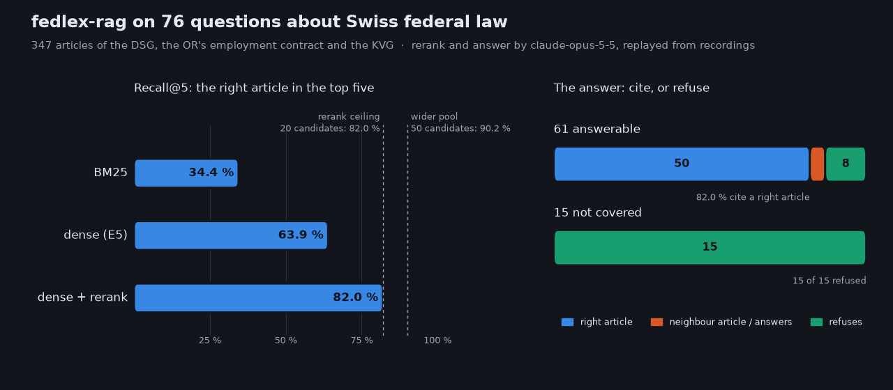
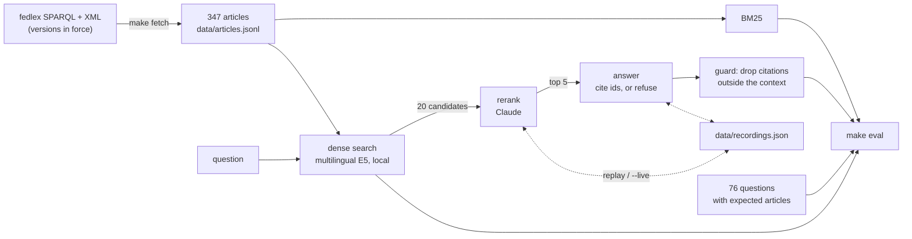

# fedlex-rag

[](https://github.com/riccardito/fedlex-rag/actions/workflows/ci.yml)

[](LICENSE)

**Answers everyday questions about Swiss federal law from the official text, cites the article, and refuses when the text does not say.**



## What this is, and what you can do with it

A retrieval pipeline over three Swiss federal acts — the data protection act (DSG), the employment-contract articles of the code of obligations (OR, Art. 319–362) and the health insurance act (KVG) — and an evaluation that measures every step of it.

- **Ask:** `make ask Q="…"` searches 347 articles, has Claude rerank the candidates, and answers in plain German with the article ids it relies on, each a link to fedlex.
- **Measure:** `make eval` scores keyword search, dense search and the rerank on 76 questions, then the answers: cited correctly, refused, or wrong.
- **Run it without a key:** every Claude answer is recorded, so `make eval` replays them with no API key, no network and no model download.
- **Rebuild the data:** `make fetch` downloads the versions in force today from fedlex and splits them into articles.

## The problem

People ask legal questions in their own words — *"Can my boss fire me while I'm pregnant?"* — and the law answers in its own: *"Nach Ablauf der Probezeit darf der Arbeitgeber das Arbeitsverhältnis nicht kündigen …"*. A search has to bridge that gap. An answer then has to stay inside the text it was given, and say so when the text does not cover the question, because a confident answer from general knowledge looks exactly like a correct one.

## The result

| On 76 questions (61 answerable, 15 outside the three acts) | Recall@5 | hit@1 |
|---|---:|---:|
| baseline: BM25 keyword search | 34.4 % | 11.5 % |
| dense search (`multilingual-e5-small`, local) | 63.9 % | 39.3 % |
| **dense search + rerank by Claude** | **82.0 %** | **82.0 %** |

| The answer, from the reranked top five | |
|---|---:|
| cites a right article (of 61 answerable) | **82.0 %** |
| refuses although answerable | 13.1 % |
| refuses a question the acts do not cover (of 15) | **100 %** |
| cites an article it was not given | **0** |

The rerank reaches its ceiling exactly. The right article is among the 20 dense candidates for 82.0 % of the questions, and whenever it is there, the rerank puts it first. So every remaining miss is a search miss — and in 8 of those 11 the answer step said the articles did not cover the question instead of guessing.

## Quickstart

```bash
git clone https://github.com/riccardito/fedlex-rag && cd fedlex-rag
python -m venv .venv && . .venv/bin/activate   # Windows: .venv\Scripts\activate
make install && make eval
```

`make install` needs only numpy and the test tools (pytest, ruff). The answers come from the recordings:

```
$ make ask Q="Ich habe nach meinem Umzug in die Schweiz zu lange gewartet, bevor ich mich bei einer Krankenkasse gemeldet habe. Muss ich dafür extra zahlen?"
Wer in der Schweiz Wohnsitz nimmt, muss sich innert drei Monaten nach der Wohnsitznahme für Krankenpflege versichern. […]

 * KVG Art. 5       https://www.fedlex.admin.ch/eli/cc/1995/1328_1328_1328/de#art_5
 * KVG Art. 3       https://www.fedlex.admin.ch/eli/cc/1995/1328_1328_1328/de#art_3
   KVG Art. 6a      https://www.fedlex.admin.ch/eli/cc/1995/1328_1328_1328/de#art_6_a
   …

$ make ask Q="Wie lange ist die Kündigungsfrist, wenn ich meine Mietwohnung verlassen will?"
Die vorliegenden Artikel betreffen nur Kündigungsfristen im Arbeitsrecht und beim Gesamtarbeitsvertrag und decken die Kündigungsfrist für eine Mietwohnung nicht ab.
```

A star marks a cited article. A question of your own needs the model and a key: `make install-llm`, then `make ask Q="…" LIVE=--live`. The key is read from `ANTHROPIC_API_KEY` or, failing that, the OS keyring (`python -m keyring set anthropic portfolio`).

## How it works



**The loader** asks fedlex's SPARQL endpoint for the newest German version of each act already in force and reads its Akoma Ntoso XML. One record per article: footnotes dropped, repealed paragraphs dropped, and the chain of headings it sits under kept with it. That chain matters. The OR's employment articles carry no heading of their own; their marginal notes sit on the levels around them, so `OR Art. 335c` is found as *Beendigung des Arbeitsverhältnisses › Kündigungsfristen › nach Ablauf der Probezeit*.

**The search** embeds each article with `intfloat/multilingual-e5-small` on the CPU; the vectors for the 347 articles and the 76 questions are committed, so the evaluation never loads the model.

**The rerank and the answer** are two calls to `claude-opus-5-5` with a JSON schema each. The rerank orders the 20 candidates by how directly their text answers the question; the answer sees the top five and must cite the ids it relies on or set `answerable: false`. Citations of an article it was not given are dropped and counted; across the 76 questions there were none. Requests go out with server-side fallbacks on: if a safety classifier declines one, the API re-runs it on the model Anthropic recommends for that category. None of the 152 recorded calls needed it.

**Each request is recorded under the SHA-256 of its full content** — model, prompt, schema, the articles. Change any of it and the recording no longer matches, so a stale answer cannot be replayed against a changed question.

## The evaluation set

76 questions with the article ids that answer them. 16 I wrote; 60 were drafted by a language model from the fixture under rules a script then checked: every question cites a sentence from its article verbatim as evidence, uses no word of the article's heading, and shares no run of four words with its text. I read all 60 as well. 15 of the 76 are about law the three acts do not contain — rent, inheritance, traffic fines, the AHV, accident insurance — and most of those are close neighbours on purpose.

## The data

The articles are the official consolidated German text from [fedlex](https://www.fedlex.admin.ch): DSG (SR 235.1) in force since 2025-07-07, OR (SR 220) since 2026-10-01, KVG (SR 832.10) since 2026-07-01, retrieved 2026-11-10. `data/sources.json` names each file. Enactments of the Confederation are not protected by copyright (Art. 5 para. 1 let. a URG), so the text is committed and `make eval` needs no download. Where the official text has a typo, so does the fixture.

## What I learned, and what is open

**The bottleneck is the search, not the model.** Opus ranked the right article first every time it was a candidate. A better reranker would change nothing here; a better candidate list would.

**A small sample told me the wrong thing.** On the first 16 questions, widening the candidate pool from 20 to 30 or to a dense-plus-keyword union changed nothing, and I concluded the misses were vocabulary, not pool size. On all 61 the ceiling rises from 82.0 % at 20 candidates to 86.9 % at 30 and 90.2 % at 50. Both effects are real; only one showed at n = 16.

**The refusals are the part I trust most.** When the right article was missing, the answer said so in 8 of 11 cases. In the other 3 it answered from a neighbouring article of the same act — a plausible answer to a slightly different question. That is the failure to watch, and the reason the evaluation counts a citation of the wrong article as wrong.

**Questions copied from the law flatter keyword search.** A question that reuses the article's words is easy for BM25 — and says nothing about real use. With heading words and copied phrases forbidden, BM25 finds the article in the top five for one question in three.

**Writing the questions fixed the data.** Checking each question's evidence against the fixture surfaced two parser bugs: a word split by a line break (*Adoptions- urlaub*) and repealed paragraphs left as a bare *3 …*; both are fixed and tested.

Open:

- A pool of 50 candidates lifts the ceiling to 90.2 %, at the cost of a longer rerank prompt. The next step.
- Rewriting the question into legal terms before the search, for the misses no pool size reaches.
- 23 of the 347 articles are longer than the model's 512-token window and are embedded truncated.
- The French and Italian texts, and more acts.

This is a portfolio project. Its answers are information about the law, not legal advice.

## Author

Built by Riccard Nef, AI engineer in Swiss healthcare IT — [LinkedIn](https://www.linkedin.com/in/riccard-nef-62683511b/) · [*The Agora Method*](https://medium.com/@stillwaiting/the-agora-method-b62263bde400).

## Licence

MIT for the code — see [LICENSE](LICENSE). The enactments are official texts of the Swiss Confederation (Art. 5 URG).
